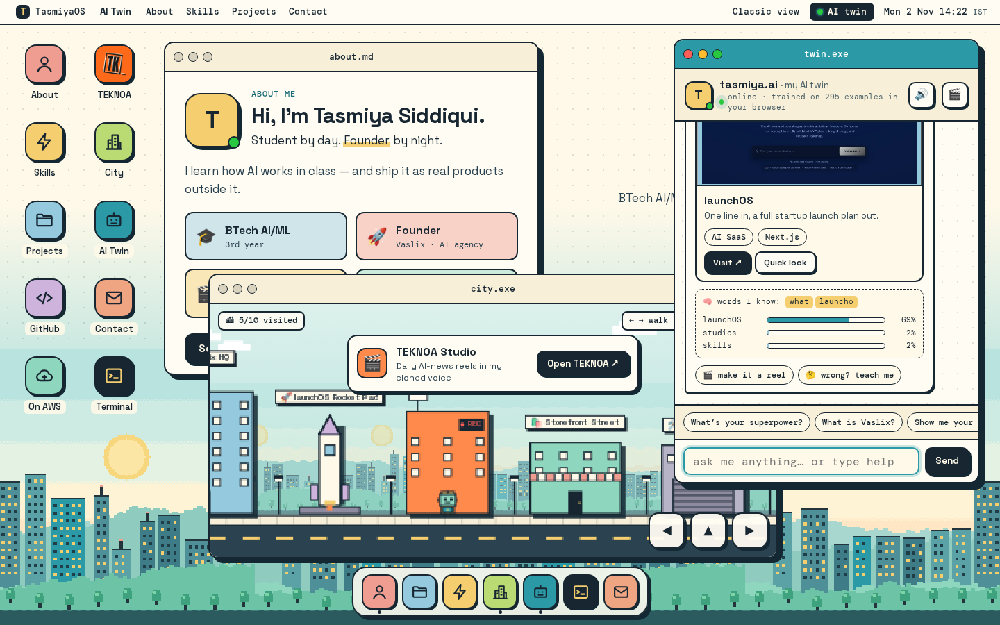

# TasmiyaOS — Tasmiya Siddiqui's portfolio (AWS Student Builder Challenge)

> **Build Your Tech Superpower** · my portfolio is a tiny computer. Open apps for About, Skills and Projects, walk a pixel city where every building is something I built, and chat with **my AI twin** — a small machine-learning model that trains in your browser. Static site on **AWS Amplify Hosting**.

**Live site:** `https://<your-amplify-domain>` ← *add after deploying* · **Classic view:** `/classic.html` (plain scrollable page)



## What's inside

| App | What it shows |
|---|---|
| **About** (opens on load) | 3rd-year BTech AI/ML student at Maharana Institute of Professional Studies, founder of the AI agency **Vaslix**, creator of **TEKNOA** |
| **Skills** | ML, AI chat & voice agents, full-stack, automation, AI content & voice cloning, AWS — as chips |
| **Projects** | a Finder window: 9 live Vaslix products + GharLeads as screenshot files, filters, achievements; click → Quick Look preview with **Visit ↗** |
| **GitHub · On AWS · TEKNOA · Contact** | repos + language bar, the GitHub → Amplify → CloudFront flow, the reel pipeline, contact buttons |
| **City** | pixel side-scroller: walk the robot (← → / tap / on-screen pad); each building pops a card and opens its app |
| **AI Twin** | chat with the in-browser ML twin; answers come as rich cards |
| **Terminal** | `help`, `whoami`, `projects`, `open <app>`, `ask <question>`, `neofetch`… and one hidden command |

On a phone the desktop becomes a **home screen**: an app grid, a dock, and apps that open as full-screen sheets with a back button (the phone's back gesture works too).

## The creative feature: talk to my AI twin `>_`

The pixel robot in the corner says **“psst — talk to my AI twin ⌨️”**. It's also in the menubar, the dock, the About window and the City (the AI Twin Café).

- **Real ML, not canned clicks.** A multinomial **Naive Bayes** intent classifier trains *in your browser* on page load (295 example questions, 24 topics).
- **Rich answers.** Ask about launchOS and you get a project card with its screenshot and a Visit button; ask about skills and you get chips; ask how to reach me and you get contact buttons.
- **It shows its thinking.** Under every answer: the words it recognised and its top-3 probabilities.
- **You can teach it.** “wrong? teach me” → pick the right topic → it retrains instantly (supervised learning, only in your browser).
- **Reel mode** (🎬) turns any answer into a 9:16 reel; **🔊** plays a greeting in an AI clone of my own voice.
- **Easter eggs.** `sudo` (in the chat or the Terminal) or the Konami code. In the City, press `N` for night mode.

No API keys, no server, no tracking — plain HTML, CSS and JavaScript.

## Deploy on AWS Amplify Hosting

1. Create a **new** public GitHub repo (e.g. `aws-portfolio`) and push this folder.
2. AWS Console → **AWS Amplify** → **Create new app** → **GitHub** → pick the repo, branch `main`.
3. Amplify reads `amplify.yml`: it runs the tests in `test/` and publishes `site/`. **Save and deploy**.
4. You get `https://main.<id>.amplifyapp.com`; every `git push` redeploys.

(Or: **Deploy without Git** and drag a zip of `site/`.) `customHttp.yml` adds security headers and asset caching.

## Run locally

```bash
cd site && python3 -m http.server 8000      # open http://localhost:8000  (add ?noboot to skip the boot screen)
node --test test/site.test.mjs test/os.test.mjs   # the same checks Amplify runs
```

Handy links: `?open=projects,twin` opens apps on load, `#city` opens one app.

## Project structure

```
site/
  index.html      TasmiyaOS: desktop, windows, dock (all content is real HTML, readable without the windows)
  classic.html    the classic, scrollable portfolio (judges / SEO / no-JS)
  os.css          the tasmiya_os look: paper, ink, pastel tiles, hard shadows, pixel world
  boot.js         decides whether the short boot screen plays (once per visit, ?noboot skips)
  wm-core.js      window manager state: z-order stack, focus, minimise, zoom, clamped dragging (no DOM)
  os.js           desktop: icons, windows, drag, dock, menubar, router, Finder + Quick Look, Terminal
  city-core.js    City game state: layout, walking, tap-to-walk, jump, visits (no DOM)
  city.js         City renderer on <canvas> (runs only while its window is visible)
  twin-data.js    the twin's training data
  twin-model.js   the Naive Bayes model (trains in the browser)
  twin-cards.js   answer cards (project, gallery, skills, contact, GitHub, TEKNOA, AWS)
  twin.js         chat UI, teach-me retraining, voice clone, reel mode, easter egg
  os-data.js      projects, skills, repos, contact and City buildings (one source for all apps)
  classic.css / classic.js   the classic view
test/site.test.mjs  required sections, hint, classic view, local files, no placeholders, model accuracy on held-out questions
test/os.test.mjs    window manager, City game, chat cards
```

## Accessibility & performance
Every icon, window button and dock item is a real button with a label; Tab/Enter open apps, arrow keys move between desktop icons, **Esc** closes the front window, **Alt+arrows** move it, focus returns to where you were. Windows are non-modal; the chat log is `aria-live`. A skip link and a **Classic view** link lead to a plain page. `prefers-reduced-motion` turns off the boot screen and animations. Self-hosted fonts, no third-party requests; the City only animates while visible.

## Credits
Design, code and content by Tasmiya Siddiqui. Fonts: Space Grotesk and DM Mono (SIL Open Font License). Project screenshots are of live sites I built at Vaslix. Pixel art and robot are original.
